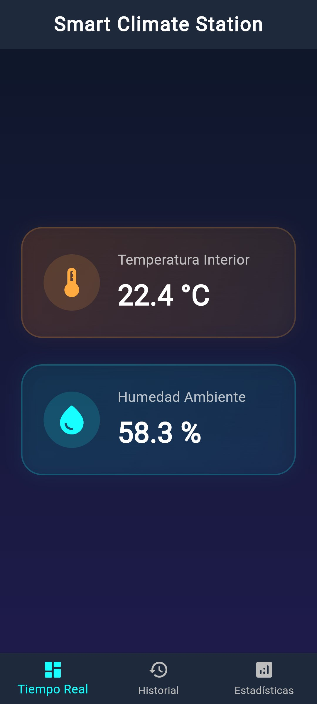
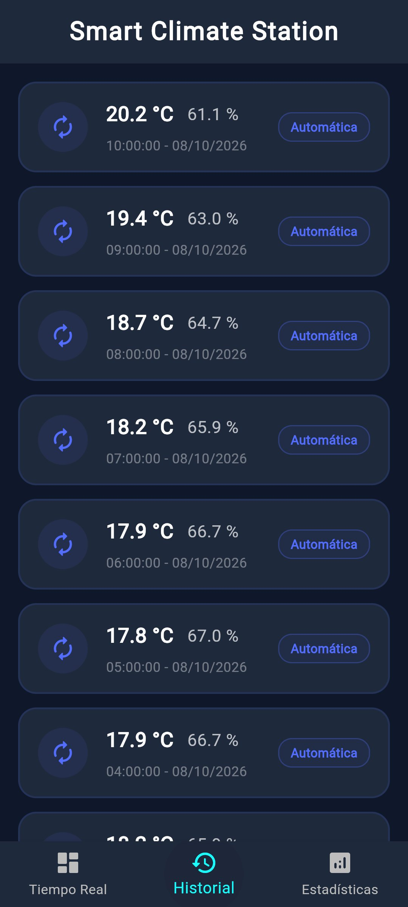
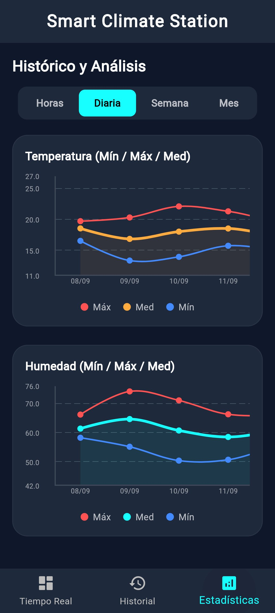
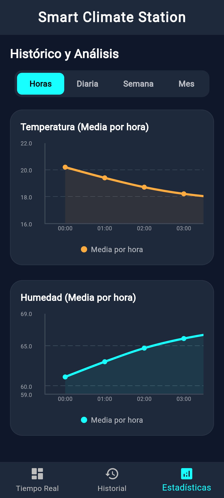
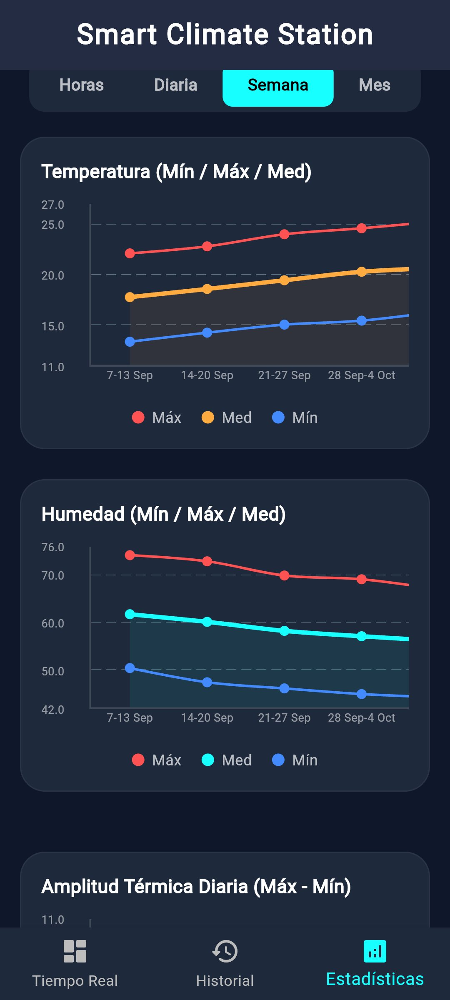
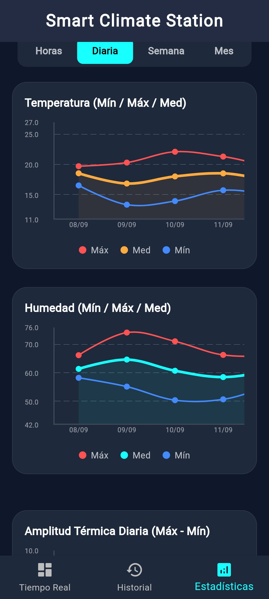

# Smart Climate Station

**Smart Climate Station** is a small IoT project that monitors indoor temperature, ambient humidity and soil moisture. An **Arduino UNO R4 WiFi** with Modulino sensors publishes readings to **Firebase Realtime Database**, and a **Flutter** app shows the live values, keeps a local history and draws statistics by hour, day, week and month.

## How it works

```
Arduino UNO R4 WiFi ──► Firebase Realtime DB ──► Flutter app ──► SQLite (local history)
 (Modulino Thermo,        sensors/ (live)            │                 │
  soil moisture sensor)   history/ (queue)           │                 ▼
                                                     └──────► Cloud Firestore (daily backup)
Cloud Function: humidity > 60 % ──► FCM push "humidityAlert" (max. once every 12 h)
```

1. **Arduino** (`arduino_code/temp/temp.ino`) measures every hour, reconnecting WiFi before each reading to avoid frozen connections. It writes the latest values to `sensors/` and queues a timestamped copy under `history/{epoch}`.
2. **Flutter app** listens to `sensors/` in real time, drains the `history/` queue into a local **SQLite** database and removes the consumed entries.
3. **Sync service** uploads the local history to **Cloud Firestore** at most once every 23 h (idempotent, batched) and restores it automatically after a reinstall.
4. **Cloud Function** (`functions/index.js`) sends a push notification through **FCM** when humidity rises above 60 %.

## Features

- **Real time** dashboard with the current temperature and humidity.
- **History** of every measurement, flagged as automatic or manual.
- **Statistics** with `fl_chart`: min / max / average temperature and humidity grouped by hours, days, weeks or months, plus daily thermal amplitude. Charts are horizontally scrollable with tooltips.
- **Offline-first**: all history lives in SQLite; Firestore is only a backup.
- **Humidity alerts** via Cloud Functions + Firebase Cloud Messaging.

## Screenshots

| Real time | History | Daily statistics |
|:---:|:---:|:---:|
|  |  |  |

| Hourly statistics | Weekly statistics | Thermal amplitude |
|:---:|:---:|:---:|
|  |  |  |

## Tech stack

- **Flutter / Dart**, `fl_chart`, `sqflite`, `shared_preferences`.
- **Firebase**: Realtime Database, Cloud Firestore, Cloud Functions (Node.js), Cloud Messaging.
- **Hardware**: Arduino UNO R4 WiFi, Modulino Thermo + Buzzer, analog soil moisture sensor.

## Project structure

```
lib/
  main.dart                  # Firebase init
  pages/home.dart            # Real time, History and Statistics tabs
  data/database_helper.dart  # SQLite schema and aggregation queries
  data/sync_service.dart     # Firestore backup / restore
arduino_code/temp/           # Arduino sketch (WiFi + Firebase credentials in secrets.h, not committed)
functions/                   # Cloud Function for humidity alerts
```

## Getting started

```bash
flutter pub get
flutter run
```

- Configure Firebase with FlutterFire (`lib/firebase_options.dart`).
- For the Arduino sketch, create `arduino_code/temp/secrets.h` with your WiFi credentials and `REFERENCE_URL` (Realtime Database URL).
- Deploy the Cloud Function with `cd functions && npm install && firebase deploy --only functions`.
